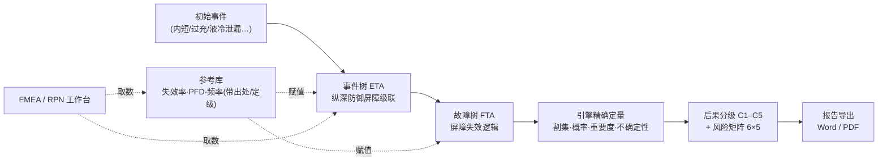
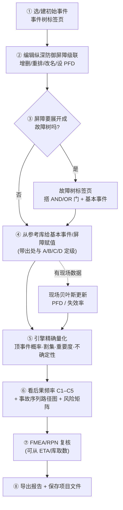
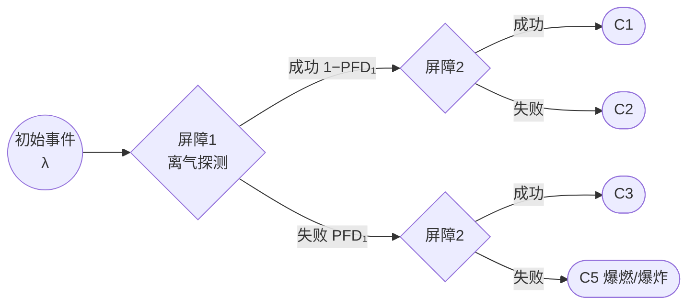
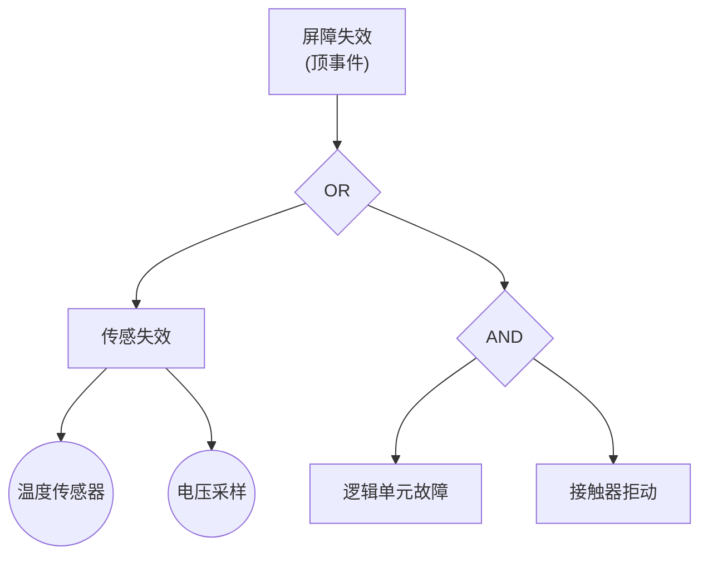
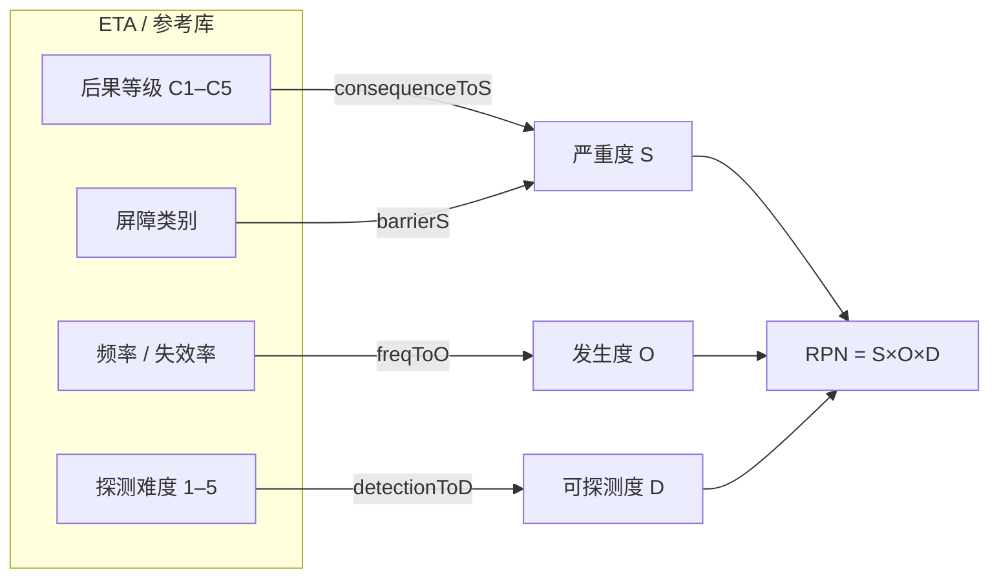
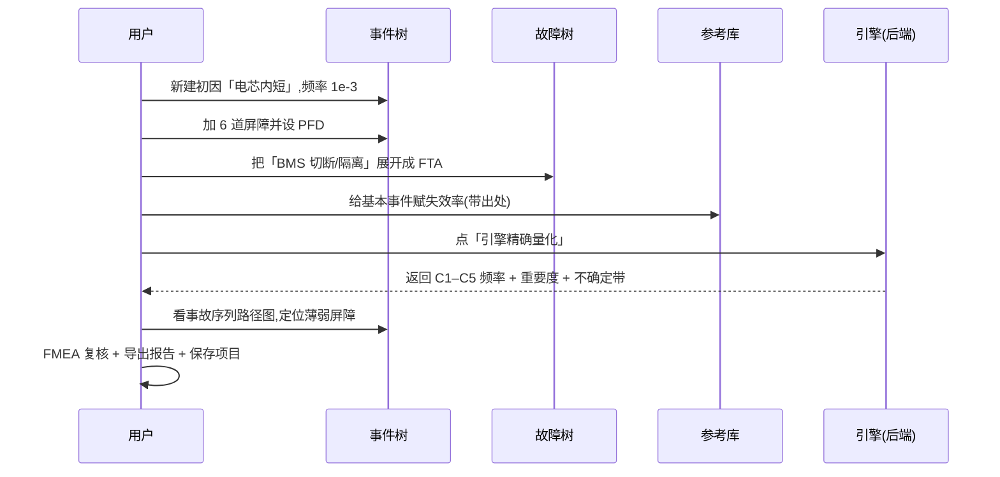

# BESS PSA / QRA 工具 —— 使用手册

面向储能(BESS)锂离子电池**热失控(Thermal Runaway, TR)**的概率安全评价工具。本手册讲“怎么用”;算法与理论见配套的[《算法设计说明书》](ALGORITHM_DESIGN.md)。

---

## 1. 这是什么

把一次电池热失控从“**初始事件 → 纵深防御屏障逐层拦截 → 后果分级**”的完整链条,用**事件树(ETA)**串起来,用**故障树(FTA)**展开每道屏障为什么会失效,再由自研**纯 Python 引擎**精确算出每种后果(C1–C5)的频率、薄弱屏障(重要度)和不确定度,最后落到**风险矩阵**与**报告**。



### 三层架构

| 层 | 目录 | 职责 |
|---|---|---|
| **引擎** | `psaengine/` | 领域无关的 FTA/ETA 定量内核:模型 · 预处理 · ROBDD/ZBDD · 割集 · 概率 · 重要度 · 蒙特卡洛 · 事件树序列 · CCF · Open-PSA MEF XML |
| **领域** | `bess/` | 热失控级联事件树、预置参考库、C1–C5 后果分级 |
| **Web** | `backend/`(FastAPI)+ `frontend/`(React + TS) | 可视化编辑、风险矩阵、重要度/不确定性、报告导出、可编辑参考库、FMEA |

> **关键约定:定量只由引擎承担。** 前端负责可编辑建模与可视化;FTA「量化」与 ETA「引擎精确量化」都通过后端 API 调引擎。引擎是唯一定量源。

---

## 2. 安装与运行

### 2.1 一键运行(推荐)

```powershell
.\run.ps1          # FastAPI 托管已构建前端 → http://127.0.0.1:8000
```

### 2.2 开发模式(前后端分离 + 热更新)

```powershell
# 后端 :8000
.\.venv\Scripts\python.exe -m uvicorn backend.app:app --port 8000
# 前端 :5173(/api 自动代理到 :8000)
npm --prefix frontend run dev
```

### 2.3 单文件离线版

```powershell
npm --prefix frontend run bundle   # → 仓库根 bess-eta-standalone.html
```

双击即可离线使用(事件树编辑、积式频率、风险矩阵、FMEA、参考库浏览/编辑)。

> ⚠️ **离线限制**:FTA/ETA 的**引擎精确量化依赖后端**(`/api`),离线不可用。需精确量化时请走 `run.ps1` 或开发模式。

### 2.4 测试

```powershell
.\.venv\Scripts\python.exe -m pytest -q   # 后端/引擎:单元·解析解·属性测试·dd 对拍·17 个 SCRAM/OpenFTA 基准
npm --prefix frontend run test            # 前端:vitest
```

---

## 3. 总体工作流



---

## 4. 五个标签页详解

### 4.1 事件树(ETA)

构建“一次初因如何被一层层屏障拦截、最终落到哪个后果”的级联树。

| 操作 | 说明 |
|---|---|
| **初始事件** | 名称 + 频率;频率三来源:手工 / 由挂载 FTA 的 `__init__` 顶事件 / 产品维度(电芯数 × 单体失效率) |
| **屏障(功能事件)** | 每列一道屏障,失败概率 PFD;支持**新增 / 删除 / ↑↓ 重排 / 双击改名** |
| **分支检视器** | 点分支节点 → 改名 / 设 PFD / 挂 FTA / 重指派;显示成功·失败分支条件概率 |
| **现场贝叶斯更新** | 屏障检视器内嵌「现场更新 PFD」:用现场需求次数 N、失败次数 k 在先验上更新(Beta-二项),写回后验均值,标记证据等级 |
| **引擎精确量化** | 调后端引擎,逐序列/逐后果精确求频率(成功分支精确否定、跨序列共享事件正确) |
| **事故序列路径图** | 底部每条序列一行(初因 → 屏障 ✓/✗ → 0–IV 分级 + 频率),点行高亮联动事件树 |
| **多 ETA 工作区** | 多棵事件树并存,项目级存档 |



**BESS 默认纵深防御链(`bess/` 预置):**

| 次序 | 屏障 | 层级 | 阶段 | PFD 先验 |
|---|---|---|---|---|
| 1 | 早期离气探测+联动 | rack | vent/off-gas | 0.01 |
| 2 | BMS 切断/隔离 | rack | trigger | 0.10 |
| 3 | 电芯间热障阻断蔓延 | module | propagation | 0.10 |
| 4 | 舱内泄爆/防爆(η=0.953) | system | deflagration | 0.10 |
| 5 | 舱间距阻断多舱蔓延 | system | multi-unit | 0.10 |
| 6 | 应急响应(避免开门引气) | system | deflagration | 0.10 |

### 4.2 故障树(FTA)

把屏障**为什么失效**展开为逻辑门。

- **画布**:React Flow 拖拽;AND / OR 门 + 基本事件 + 中间事件(门带描述)。
- **挂载到 ETA 屏障**:某屏障的失效 = 一棵 FTA 顶事件,二者联动。
- **自建工作区**:与 ETA 无关的独立故障树,可多棵并存。
- **量化**(对所有目标开放:示例 / ETA 挂载 / 自建):最小割集、Fussell-Vesely / Birnbaum / RAW / RRW 重要度热力、截断研究。
- **保存项目**:FTA 标签页也可「保存项目 / 导出文件」。



### 4.3 参考库

可靠性数据的单一来源:**器件失效率 / 屏障 PFD / 初始事件频率**,每条带**出处**与 **A/B/C/D 置信定级**。

| 能力 | 说明 |
|---|---|
| **三类数据** | 器件失效率(/yr 或 /h 等)、屏障 PFD、初因频率 |
| **置信定级** | A(现场/实测)· B(行业统计)· C(手册/标准)· D(类比/推断);颜色区分,可筛选 |
| **探测维度** | 屏障带 探测难度(1–5)/ 是否静默 / 前兆信号 |
| **现场贝叶斯更新** | 屏障 PFD 走 Beta-二项;器件/初因频率走 Poisson-Gamma;更新后定级升 A 并附证据链 |
| **可编辑/扩展** | localStorage 覆盖层,可手动增改条目;可导出参考库 |

### 4.4 FMEA / RPN 工作台

把同一套数据按 **FMEA** 口径复核:风险优先数 **RPN = S × O × D**。

| 元素 | 说明 |
|---|---|
| **可编辑表** | 对象 / 失效模式 / S / O / D(1–10 直接点改),自动算 RPN、AP(高/中/低)、S≥9 红标 |
| **⚙ 映射配置(可折叠)** | 全部映射可在面板编辑:后果→S、频率→O(阈值+O 均可改)、探测→D、屏障类别→S、器件缺省 S;即时本地保存、「恢复默认」、「按映射重算导入行」 |
| **从参考库导入** | 屏障按类别推断 S(warning/active/passive → 6/8/9),器件用缺省 S;频率→O、探测→D |
| **从当前 ETA 取** | 末态行用精确后果等级→S;屏障行 S 取“该屏障失败分支可达末态的最重后果” |
| **S×D 矩阵 + CSV** | 5×5 严重度×可探测度落点矩阵;一键导出 CSV |



### 4.5 风险矩阵与报告

- **6×5 风险矩阵**(对齐中电联口径):6 个频率档 × 5 个严重度档;后果映射 C1→I / C2→II / C3→III / C4·C5→IV。
- **报告导出**:Word / PDF(内置 CJK 字体);含 C1–C5 内涵、主导序列、屏障重要度、FTA 割集。

---

## 5. 项目文件(离线存档)

- **导出文件**:把当前所有 ETA、自建 FTA、参数、FMEA 等序列化为一个 `.json` 项目文件。
- **导入文件**:从 `.json` 恢复;旧版本字段缺省安全。
- 纯前端,离线可用,便于备份与交接。

---

## 6. 典型操作:从零做一次评价



---

## 7. 常见问题

| 问题 | 答复 |
|---|---|
| 量化按钮点了没反应? | 量化依赖后端;请用 `run.ps1` 或开发模式启动 `:8000`。离线单文件版不含引擎。 |
| 现场更新会改我的参考库吗? | 会写回该条的后验值并升级定级;原始先验出处保留在证据链中。 |
| 改了 FMEA 映射,已导入的行变了吗? | 不会自动变;点「按映射重算导入行」可把新映射套用到库/ETA 导入行(保留手动行)。 |
| `grade` / 证据等级会影响引擎计算吗? | 不会;它们是数据治理标注,不进 MEF 量化契约。 |

---

*配套阅读:[《算法设计说明书》](ALGORITHM_DESIGN.md) —— 涵盖 FTA/ETA/BDD/割集/重要度/CCF/蒙特卡洛/贝叶斯/FMEA 的完整理论与公式。*
