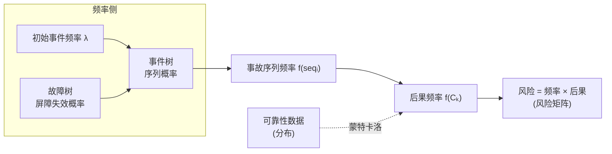
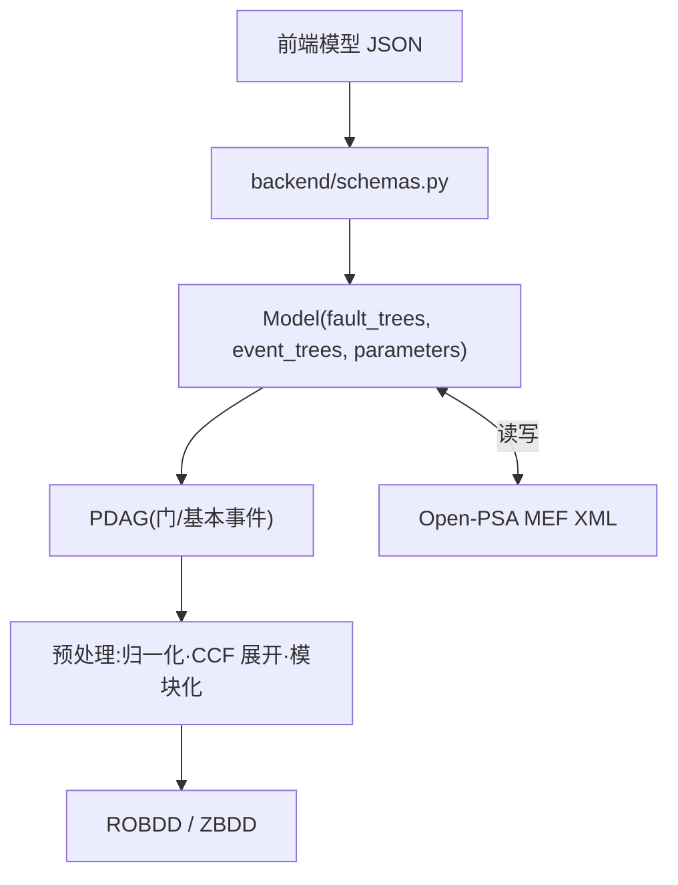
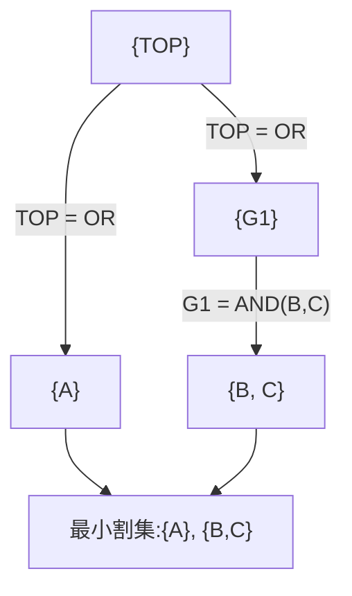
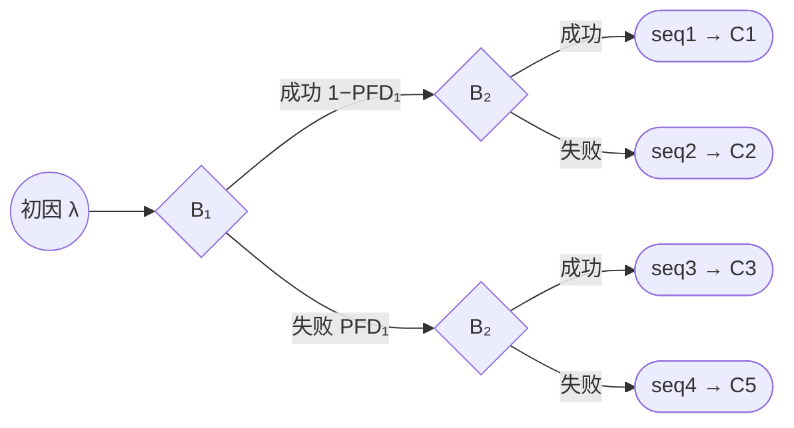
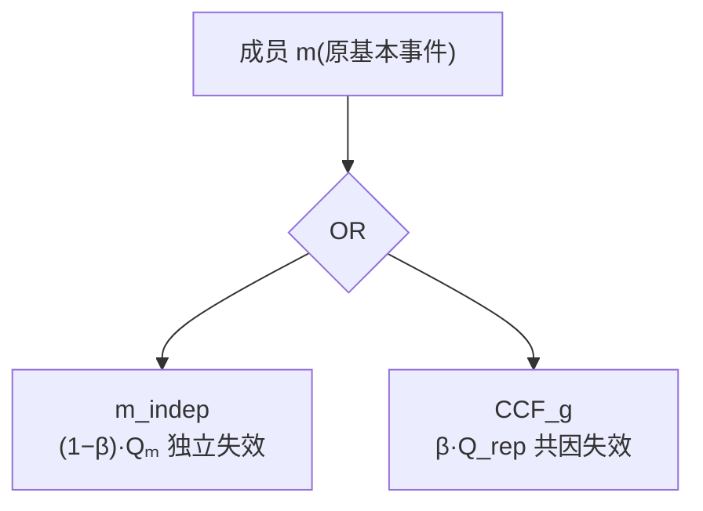
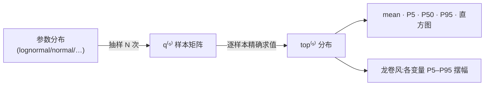
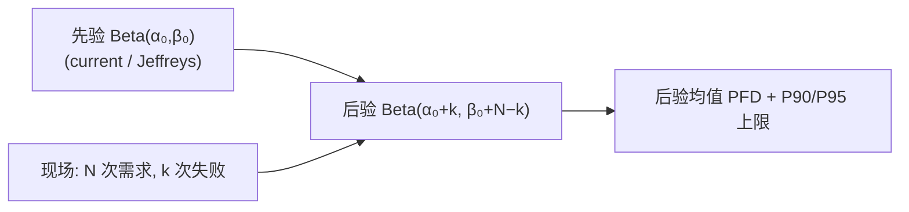
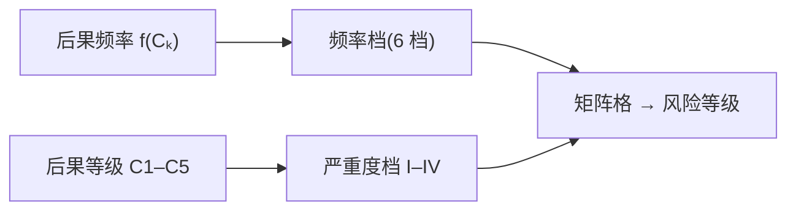
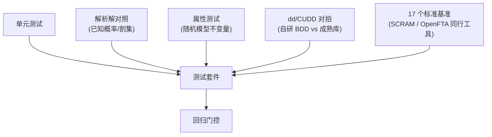

> **已归档(2026-07-14)**:本文档内容已并入权威手册
> [《BESS-PSA-TD-001 技术文档》](../BESS-PSA-TD-001-技术文档.html)(使用手册 → §5,算法 → §3–§4),此处仅保留历史版本,不再随代码更新。

# BESS PSA / QRA 工具 —— 算法设计说明书

本说明书系统阐述工具背后的**概率安全评价(PSA)/ 定量风险评价(QRA)**理论与算法实现:故障树、事件树、二元决策图、最小割集、顶事件概率、重要度、共因失效、不确定性传播、贝叶斯现场更新、FMEA 及后果/风险分级。每节给出**数学定义 + 工程实现 + 图示**。

> 实现位置以 `psaengine/`(纯 Python 引擎)与 `frontend/src/`(TypeScript)为准。引擎是唯一定量源。

---

## 目录

1. [PSA/QRA 理论框架](#1-psaqra-理论框架)
2. [模型表示:PDAG 与 Open-PSA MEF](#2-模型表示pdag-与-open-psa-mef)
3. [故障树定量](#3-故障树定量)
4. [重要度分析](#4-重要度分析)
5. [事件树定量](#5-事件树定量)
6. [共因失效 CCF](#6-共因失效-ccf)
7. [不确定性传播](#7-不确定性传播)
8. [贝叶斯现场更新](#8-贝叶斯现场更新)
9. [FMEA / RPN](#9-fmea--rpn)
10. [后果分级与风险矩阵](#10-后果分级与风险矩阵)
11. [可靠性数据与置信定级](#11-可靠性数据与置信定级)
12. [验证与对标](#12-验证与对标)
13. [符号表与参考文献](#13-符号表与参考文献)

---

## 1. PSA/QRA 理论框架

概率安全评价的核心是回答三个问题:**会出什么事?多大可能?后果多重?**(Kaplan & Garrick 风险三元组 $\langle s_i, p_i, x_i \rangle$)。

本工具的 BESS 应用:**初始事件**(内短、过充、液冷泄漏、外部火、机械损伤/进水)→ 经**纵深防御屏障**级联(事件树)→ 每道屏障的失效逻辑(故障树)→ 精确定量 → **C1–C5 后果**频率与不确定带。

---

## 2. 模型表示:PDAG 与 Open-PSA MEF

- **PDAG**(Propositional Directed Acyclic Graph,`psaengine/model/pdag.py`):门(AND/OR/NULL/…)、基本事件、房事件(house)、参数引用的统一图表示。故障树、事件树链接的屏障逻辑都归一到 PDAG。
- **参数库**(`parameters.py`):基本事件的不可用度 $q$ 及其不确定分布。
- **Open-PSA MEF**(`mef_xml.py`):工具可读写 [Open-PSA Model Exchange Format](https://open-psa.github.io/mef/) 标准 XML,实现模型与第三方工具(SCRAM 等)互通。
- **MEF 契约**:数据治理标注(如 `grade`、证据链)**不进入** MEF 量化契约,保证定量可复现。

---

## 3. 故障树定量

### 3.1 最小割集(MOCUS)

**最小割集(MCS)** 是使顶事件发生的最小基本事件集合。引擎用自顶向下 **MOCUS**(`quantify/mocus.py`):

- **OR 门增行**(并联展开为多行),**AND 门扩列**(串联并入同一行);
- 反复展开直到每行全为基本事件;
- **吸收最小化**:按基数排序,删去任何已有割集的超集。

可选 `limit_order` 按阶截断(只保留基数 ≤ k 的割集),控制组合爆炸。

### 3.2 ROBDD / ZBDD

- **ROBDD**(Reduced Ordered BDD,`bdd/kernel.py`):基于 Shannon 分解 $f = x_i\,f_{x_i=1} + \overline{x_i}\,f_{x_i=0}$ 的规约有序图,**精确**表示布尔函数。引擎自研纯 Python 内核,亦可挂 `dd`/CUDD 后端(`dd_backend.py`)做对拍。
- **ZBDD**(Zero-suppressed BDD,`zbdd.py`):适合稀疏集合族,高效表示**割集集合**。

### 3.3 顶事件概率

设基本事件不可用度 $q_i$。三种算法(`quantify/probability.py`):

**① 精确(BDD Shannon 自底向上遍历)** —— 无近似误差:

$$\Pr(f) = q_i\cdot\Pr(f_{x_i=1}) + (1-q_i)\cdot\Pr(f_{x_i=0})$$

两个余因子分支互斥,故逐节点记忆化求值即得精确顶事件概率;仅经遍历协议访问 BDD,纯 Python 与 CUDD 后端通用。

**② 稀有事件近似 REA(上界)** —— $Q_i$ 为第 $i$ 个割集概率:

$$Q_{\text{top}} \approx \sum_i Q_i$$

**③ 最小割集上界 MCUB(Esary–Proschan)**:

$$Q_{\text{top}} \approx 1 - \prod_i (1 - Q_i)$$

> 关系:$Q_{\text{exact}} \le Q_{\text{MCUB}} \le Q_{\text{REA}}$。低概率稀有事件下三者趋于一致;需严格值时用 ①。

### 3.4 截断研究与收敛监控

`quantify/truncation.py`:对一组降序截断限 $c$ 分别求最小割集并以 MCUB 估值,记录相邻差

$$\Delta P_k = \left| P(c_k) - P(c_{k-1}) \right|$$

用于 **Jung 收敛监控**——当 $\Delta P_k$ 足够小,说明截断已收敛、丢弃的割集贡献可忽略。

### 3.5 变量排序与模块化

- **变量排序**(`ordering/heuristics.py`):BDD 规模对变量序极敏感;采用结构启发式(如 DFS/权重)降低 BDD 节点数。
- **模块化(Dutuit–Rauzy)**(`preprocess/modules.py`):**模块**=某门的子树叶子不在该子树之外出现。先独立求解模块再代回,显著缩小问题规模。
- **非相干素蕴涵**(`quantify/prime_implicants.py`):含 NOT 的非相干系统用 Coudert–Madre 元积法求素蕴涵。

---

## 4. 重要度分析

定位“最该治理哪道屏障/部件”。记基线顶事件概率 $h=h(\mathbf{q})$,把第 $i$ 个事件强制为必发生 $h(1_i)$、必不发生 $h(0_i)$(`importance/measures.py`,等价于 BDD 偏导,复用精确求值):

| 重要度 | 公式 | 含义 |
|---|---|---|
| **Birnbaum** | $I^{B}_i = h(1_i) - h(0_i) = \dfrac{\partial h}{\partial q_i}$ | 顶事件对该事件的敏感度 |
| **Fussell–Vesely** | $I^{FV}_i = \dfrac{h - h(0_i)}{h}$ | 该事件对当前风险的贡献占比 |
| **RAW**(风险增值) | $I^{RAW}_i = \dfrac{h(1_i)}{h}$ | 该事件必发生时风险放大倍数 |
| **RRW**(风险降值) | $I^{RRW}_i = \dfrac{h}{h(0_i)}$ | 该事件完美可靠时风险缩小倍数 |
| **DIM**(微分,未归一) | $I^{DIM}_i = I^{B}_i \cdot q_i$ | 兼顾敏感度与当前取值 |

> FV 用于**找贡献最大**的薄弱环节;RAW 用于**配置管理/技术规范**(哪个设备绝不能失效)。

---

## 5. 事件树定量

### 5.1 序列与后果

事件树从初始事件出发,逐道屏障分叉(成功/失败),每条路径终于一个末态,末态归入后果类 $C_k$。

### 5.2 精确序列概率(关键:成功分支精确否定)

引擎(`eta/sequence.py`)把**所有功能事件链接的故障树合并到同一个 PDAG 与同一个 BddManager**,各功能事件顶事件构成 BDD $g_j$。某序列沿路径取各屏障的成功/失败分支:

$$f(\text{seq}) = \lambda_{IE}\cdot \Pr\!\Big( \bigwedge_{j\in\text{path}} B_j \Big),\quad
B_j = \begin{cases} g_j & \text{失败分支} \\ \neg g_j & \text{成功分支}\end{cases}$$

> **为什么精确**:成功分支需要对屏障取**逻辑否定** $\neg g_j$。若各屏障独立算否定会在**共享基本事件**上出错;本实现因所有 $g_j$ 共享同一 BDD 管理器,$\neg g_j$ 与跨序列共享事件被自动、精确处理。

后果频率按末态聚合:

$$f(C_k) = \sum_{\text{seq}\,\to\,C_k} f(\text{seq})$$

### 5.3 扰动法屏障重要度

通过 `fe_overrides` 把某功能事件顶 BDD 强制为常量(必失效 `one` / 必有效 `zero`),重算后果频率即得屏障层级的重要度——且不动其底层共享事件,保证一致性。

---

## 6. 共因失效 CCF

多重冗余设备常因**同一根因**同时失效(CCF),是冗余系统风险的主导项。引擎(`preprocess/ccf_expand.py`)采用 **Beta 因子**展开:把同组每个成员基本事件 $m$ 原位改写为

$$m \;\longrightarrow\; \text{OR}\big(m_{\text{indep}},\; \text{CCF}_g\big)$$

$$Q(m_{\text{indep}}) = (1-\beta)\,Q_m, \qquad Q(\text{CCF}_g) = \beta\cdot Q_{\text{rep}}$$

其中 $Q_{\text{rep}}$ 为组代表(首成员)概率。$m$ 变门后所有父引用自动指向该 OR,无需改父。

数据结构 `CCFGroup{members, model∈{beta,mgl,alpha,phi}, factors}`。**MGL / Alpha** 模型目前以其 $\beta$(首因子)分量近似。

---

## 7. 不确定性传播

可靠性参数本身有不确定性。引擎(`uncertainty/montecarlo.py`)用**蒙特卡洛**抽样每个参数的分布,逐样本调精确求值,得顶事件概率的分布。

| 分布 | 参数 | 抽样 |
|---|---|---|
| **对数正态** lognormal | median, error factor $EF$ | $\sigma = \ln(EF)/1.645$(即 $EF=e^{1.645\sigma}$,95 分位/中位) |
| **正态** normal | mean, sd | — |
| **均匀** uniform | low, high | — |
| **Beta** | a, b | — |

流程:对 $N$ 个样本,$q^{(s)}=\{$各参数抽样值$\}$,$\text{top}^{(s)}=\Pr(f\mid q^{(s)})$(精确求值,夹到 $[0,1]$)。输出:

$$\text{mean},\; P_5,\; P_{50},\; P_{95},\; \text{直方图}$$

可选 **龙卷风图(tornado)**:对每个变量取其 $P_5/P_{95}$ 代入、其余取基线,摆幅 $|\,h(q@P_{95}) - h(q@P_5)\,|$ 降序排列,识别不确定性主控因子。

---

## 8. 贝叶斯现场更新

把**通用先验**与**现场证据**融合,得到项目专属的后验估计——本工具的特色能力(`frontend/src/bayes.ts`,纯前端可离线)。采用共轭族,闭式更新。

### 8.1 屏障 PFD —— Beta-二项共轭

屏障在 $N$ 次需求中失败 $k$ 次。先验 $\text{Beta}(\alpha_0,\beta_0)$,二项似然,后验仍为 Beta:

$$\text{先验 }\text{Beta}(\alpha_0,\beta_0)\;\xrightarrow{\;N\text{ 次需求},\,k\text{ 次失败}\;}\;\text{后验 }\text{Beta}(\alpha_0+k,\;\beta_0+N-k)$$

$$\hat{\text{PFD}}_{\text{post}} = \frac{\alpha_0+k}{\alpha_0+\beta_0+N},\qquad
\text{单侧上限}=\text{BetaQuantile}(0.90\text{ 或 }0.95;\,\alpha,\beta)$$

**先验设定**:
- `current`(以现值为先验中心,等效样本量 $n_0$):$\alpha_0=\text{PFD}\cdot n_0,\;\beta_0=(1-\text{PFD})\cdot n_0$;
- `jeffreys`(无信息):$\text{Beta}(0.5,\,0.5)$。

数值:正则化不完全 Beta $I_x(a,b)$ 用 Numerical Recipes 连分式(`betai`/`betacf`/Lanczos `gammaln`),分位由 $I_x$ 二分求逆(`betaQuantile`)。

> **示例**:无信息先验 + 22 次需求 0 失败 → 90% 置信 $\text{PFD}\le \text{BetaQuantile}(0.9;1,23)\approx 0.0994$,即可验证“PFD ≤ 0.1”(LOPA 先验)。

### 8.2 失效率 / 频率 —— Poisson-Gamma 共轭

器件/初因在曝露 $T$(单元·年)内发生 $k$ 次。先验 $\text{Gamma}(\alpha_0,\beta_0)$,泊松似然,后验仍为 Gamma:

$$\text{先验 }\text{Gamma}(\alpha_0,\beta_0)\;\xrightarrow{\;T\text{ 曝露},\,k\text{ 次}\;}\;\text{后验 }\text{Gamma}(\alpha_0+k,\;\beta_0+T)$$

$$\hat{\lambda}_{\text{post}} = \frac{\alpha_0+k}{\beta_0+T},\qquad
\text{上限}=\text{GammaQuantile}(0.90\text{ 或 }0.95;\,\alpha,\beta)$$

先验 `current`:$\alpha_0=\lambda\cdot n_0,\;\beta_0=n_0$。Gamma 分位用正则化不完全 Gamma `gammp`(NR)+ 二分。

> 更新后该参考库条目**定级升 A**(现场实测)并附证据链,供后续追溯。

---

## 9. FMEA / RPN

FMEA 从“失效模式”视角并行复核,与 ETA/参考库共享数据(`frontend/src/fmea.ts`)。

$$\text{RPN} = S \times O \times D,\qquad S,O,D\in[1,10]$$

| 维度 | 含义 | ←映射来源 |
|---|---|---|
| **S** 严重度 | 后果有多重 | 后果等级 C1–C5 / 屏障类别 |
| **O** 发生度 | 多大概率发生 | 频率 / 失效率(对数分档) |
| **D** 可探测度 | 多难被提前发现 | 探测难度 1–5 |

**行动优先级 AP**:RPN ≥ 200 高 / 80–199 中 / < 80 低;**强制优先**:$S\ge 9$(无论 RPN)。

**可配置映射 `MappingConfig`**(全部可在「⚙ 映射配置」面板编辑):

| 映射 | 默认 |
|---|---|
| `consequenceToS`(C1–C5→S) | 2 / 4 / 6 / 8 / 10 |
| `freqToO`(对数分档,阈值+O 可编辑) | ≥1e-1→9, ≥1e-2→7, ≥1e-3→5, ≥1e-4→4, ≥1e-5→3, 更低→2 |
| `detectionToD`(难度 1–5→D) | 2 / 4 / 6 / 8 / 10,缺省 6 |
| `barrierCategoryToS`(屏障类别→S) | warning 6 / active 8 / passive 9,缺省 7 |
| `componentDefaultS`(器件缺省 S) | 6 |

> **设计取向**:越深的纵深防御层失效 → 下游可用防护越少 → 后果越重,故 warning < active < passive。**ETA 取数**时屏障行的 S 取“该屏障失败分支可达末态的最重后果严重度”,比固定值更精细。

**S×D 矩阵**:各维 $\lceil x/2 \rceil$ 映射到 1–5 档,$S_{\text{band}}\times D_{\text{band}}\ge 16$ 高 / $\ge 8$ 中 / 其余低。

---

## 10. 后果分级与风险矩阵

**C1–C5 后果**(BESS 热失控逐级升级):

| 级 | 内涵 | 风险矩阵严重度 |
|---|---|---|
| **C1** | 单体排气/离气,无蔓延,可恢复 | I |
| **C2** | 模组内蔓延,局部热损 | II |
| **C3** | 电池簇/单舱火灾 | III |
| **C4** | 系统/多舱火灾 | IV |
| **C5** | 爆燃/爆炸+毒气释放,人员伤亡/结构破坏 | IV |

**6×5 风险矩阵**(对齐中电联口径):6 个频率档(频发…几乎不可能)× 5 个严重度档,频率档由 $f(C_k)$ 落档,严重度由 C→I/II/III/IV 映射;每格给 A/B/C 区域子等级与最终评价。

---

## 11. 可靠性数据与置信定级

参考库每条数据带**出处**与 **A/B/C/D 置信定级**:

| 级 | 来源性质 |
|---|---|
| **A** | 现场/实测(含贝叶斯现场更新结果) |
| **B** | 行业统计 |
| **C** | 手册/标准(NPRD、OREDA、IEC 61508/61511、CCPS LOPA、NFPA…) |
| **D** | 类比/推断/示例 |

定级驱动数据治理:低级别数据优先用现场证据经第 8 节贝叶斯更新升级。屏障另带**探测维度**(探测难度 1–5 / 是否静默 / 前兆信号),供 FMEA 的 D 维与预警分析使用。

---

## 12. 验证与对标

引擎正确性通过多层防线保证(`pytest`):

- **解析解**:小模型手算概率/割集逐一比对;
- **属性测试**:随机生成模型,校验单调性、上下界关系($Q_{\text{exact}}\le Q_{\text{MCUB}}\le Q_{\text{REA}}$)等不变量;
- **dd 对拍**:自研 ROBDD 与 `dd`/CUDD 结果一致;
- **同行对标**:17 个模型对标 SCRAM / OpenFTA 公开结果。

---

## 13. 符号表与参考文献

### 符号

| 符号 | 含义 |
|---|---|
| $q_i,\;Q_i$ | 基本事件不可用度 / 割集概率 |
| $h,\;h(1_i),\;h(0_i)$ | 顶事件概率(基线 / 第 $i$ 事件置 1 / 置 0) |
| $g_j$ | 第 $j$ 功能事件(屏障)顶事件 BDD |
| $\lambda_{IE}$ | 初始事件频率 |
| $\beta$ | CCF Beta 因子 |
| $\alpha,\beta$(8 节) | Beta/Gamma 分布形状/率参数 |
| $N,k,T$ | 需求次数 / 失效次数 / 曝露 |
| $EF$ | 对数正态误差因子 |

### 参考文献

- NUREG-0492, *Fault Tree Handbook*; NASA, *Fault Tree Handbook with Aerospace Applications*.
- Rauzy A., *BDD for reliability studies*; Dutuit & Rauzy, *Efficient algorithms… modules / importance* (2000).
- Coudert & Madre, *Implicit prime implicants*(非相干系统).
- Esary & Proschan(MCUB 上界);Jung et al.(截断收敛).
- CCPS, *Layer of Protection Analysis (LOPA)* (2001);IEC 61508 / IEC 61511(SIL).
- Kaplan & Garrick, *On the Quantitative Definition of Risk* (1981).
- Open-PSA, *Model Exchange Format*;SCRAM、OpenFTA(对标工具).
- BESS 领域:UL 9540A、NFPA 855 / 68 / 69、IEC 62933 / 62619、GB/T 36276 / GB 44240、EPRI BESS Failure Incident Database、DNV GL BESS QRA (2019)、McMicken (2019) 事故调查。

---

*配套阅读:[《使用手册》](USER_GUIDE.md) —— 安装、运行、五个标签页的操作说明。*
